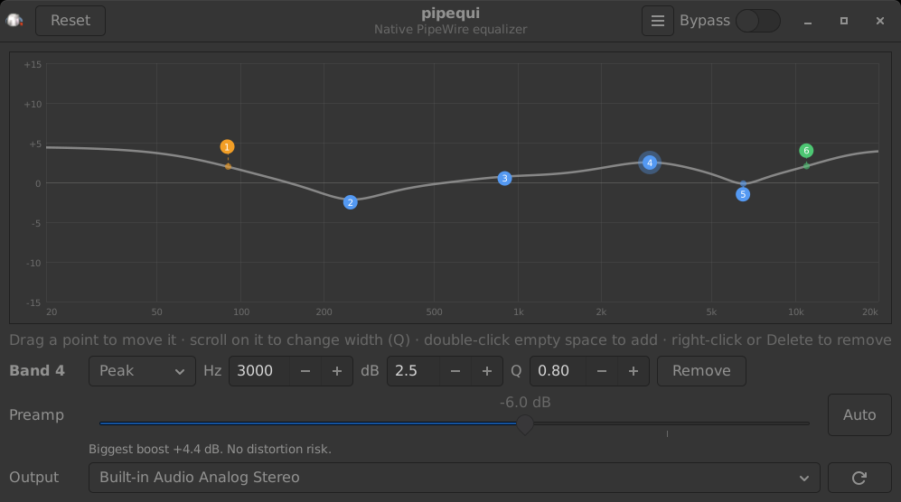

# pipequi

A native PipeWire equalizer GUI: a parametric EQ that runs inside PipeWire itself, with no background process.



Website: https://pipequi.kuritzu.de

The EQ is a PipeWire filter-chain loaded from `~/.config/pipewire/pipewire.conf.d/pipequi.conf`, so it runs inside PipeWire whether the window is open or not. The window only edits it: every change is sent to the running filter with `pw-cli` (no restart, Bluetooth stays connected) and written back to the config file so it survives a reboot.

## Setup

Open pipequi and press **Set up**. That's it: pipequi adds the equalizer to PipeWire as a new output called "Equalizer (pipequi)", sends it to the device you were already using, and makes it your default output. PipeWire restarts once, so sound stops for a second; Bluetooth headphones are reconnected automatically.

To undo it, open the menu (top right) and choose **Remove from PipeWire**. Sound goes straight to your device again, and your bands are kept for next time.

## Use

- Drag a point to change its frequency and gain (hold `Ctrl` to snap gain to 0.5 dB).
- Scroll on a point to make it wider or narrower (Q).
- Double-click empty space to add a peak band; right-click a point to change its type or remove it, or select it and press `Delete`.
- The dashed line under each point shows where the overall curve really is at that frequency, since neighbouring bands add up.
- **Preamp** lowers the overall level so boosts don't distort; **Auto** sets it to the biggest boost.
- **Output** picks the device the EQ plays into.
- **Bypass** turns the EQ off without losing the settings.

## How it works

The EQ is a PipeWire filter-chain loaded from `~/.config/pipewire/pipewire.conf.d/pipequi.conf`, so it runs inside PipeWire whether the window is open or not; nothing of pipequi stays running. The window only edits it: every change is sent to the running filter with `pw-cli` (no restart, Bluetooth stays connected) and written back to the config file so it survives a reboot.

Adding a band or changing its type would normally mean rebuilding the filter and restarting PipeWire. Instead the filter holds a fixed pool of slots chained together: 12 peaking, 4 low-shelf and 4 high-shelf biquads plus a preamp. Unused slots sit at 0 dB, which passes sound through unchanged, and bands are mapped onto slots of their type on every change. PipeWire computes the filters at the real sample rate; the window draws the curve with the same formulas at 48 kHz.

Settings live in `~/.config/pipequi/state.json`.

## Requirements

- PipeWire with WirePlumber, run as systemd user services (the default on current Debian, Ubuntu, Fedora and Arch). Without systemd, Set up still writes the config and asks you to log out and back in.
- PipeWire's command-line tools `pw-cli`, `pw-dump` and `pw-metadata`: `pipewire-bin` on Debian/Ubuntu, `pipewire-utils` on Fedora, part of `pipewire` on Arch.
- Python 3.8+ with PyGObject and GTK 3: `python3-gi gir1.2-gtk-3.0` on Debian/Ubuntu, `python3-gobject gtk3` on Fedora, `python-gobject gtk3` on Arch.
- Optional: `bluetoothctl` (BlueZ), used to reconnect Bluetooth headphones after the one restart.

## Install

On Debian or Ubuntu, download the `.deb` from the [latest release](https://github.com/kritzerenkrieg/pipequi/releases/latest) and install it:

```
sudo apt install ./pipequi_*_all.deb
```

Anywhere else, run it from a checkout (installs a `pipequi` command and a menu entry for your user):

```
git clone https://github.com/kritzerenkrieg/pipequi && cd pipequi && ./install.sh
```

To build the `.deb` yourself: `./build-deb.sh 0.1.0`. Pushing a `v*` tag builds it in GitHub Actions and attaches it to a release.

## License

MIT
